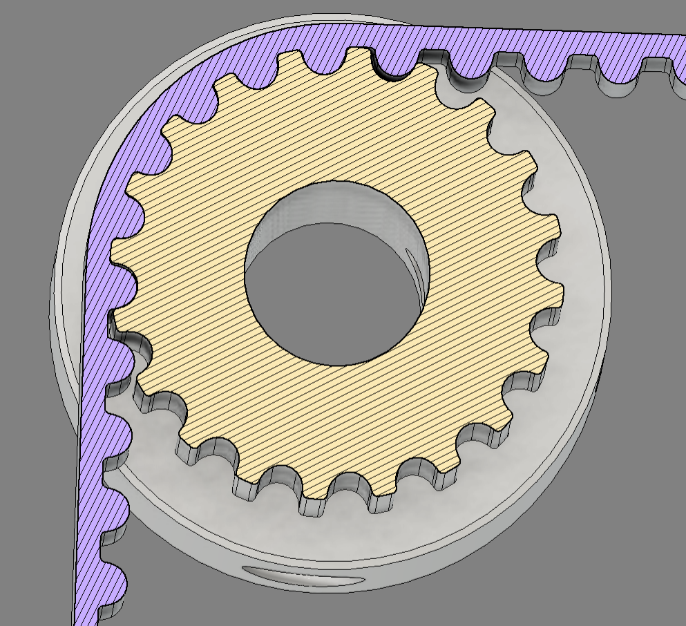
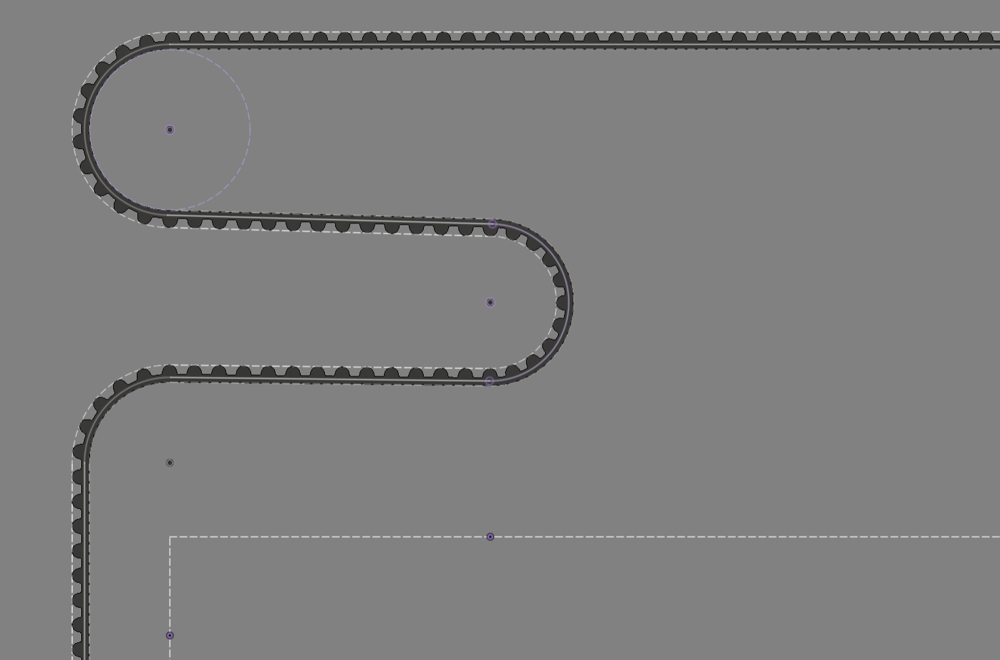
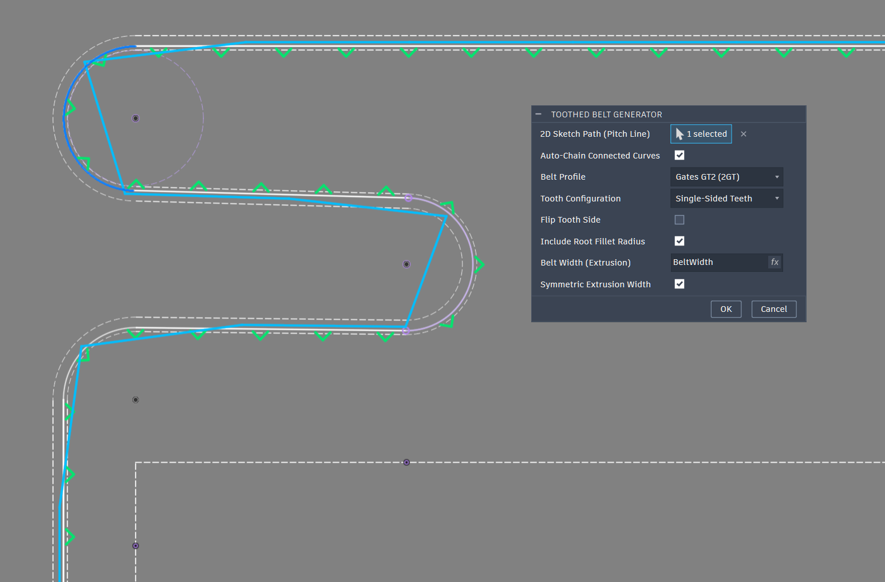
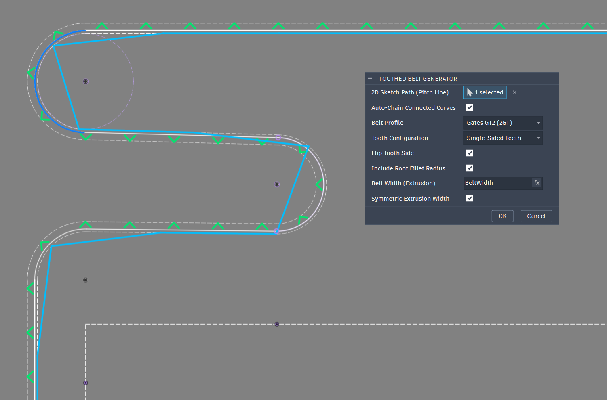

# AutoDesk Fusion - Toothed Profile Belt Generator Tool

> **Disclaimer:** This project was vibe coded using Gemini AI. I have tried to use parametric CAD in Fusion multiple times to create a curved belt path, but could never get the results I wanted.

___

This Add-in will generate a toothed belt profile along a 2d sketch. It currently supports Gates GT1.5, Gates GT2, HTD 5M and HTD 8M timing belts. It can also create double sided toothed belts, default is single sided.  
  
It will show a preview with which side the teeth will be generated on, you can flip the tooth side if needed. The belt width can be driven with a parameter value as well.  
  
The last option is to make the belt extrude symmetric from the sketchline, default is to extrude up the width of the belt.

___

___

___

___

**Drawing the Belt path:**

The belt path is drawn along the Pitch Diameter Line (PLD), for pulleys you just need to enter this formula into the dimmension box `(Tooth Count*Pitch) / PI`, for a 20t GT2 pulley that would look like `(20*2) / PI`. Just remember this is for the Diameter, half the value for the Radius.  
  
For smooth idlers or bearing stacks on the backside you will need to use the backside to PLD offset from the table below. And if you use smooth idlers for the tooth side, that would be the Tooth Height + PLD value.
| Belt Profile | Pitch ($p$) | Tooth Height ($h_t$) | Backing Thickness ($h_b$) | PLD | Backside-to-PLD Offset ($h_b - \text{PLD}$) |
| :--- | :--- | :--- | :--- | :--- | :--- |
| **Gates GT1.5 (1.5GT)** | 1.50 mm | 0.56 mm | 0.44 mm | 0.230 mm | 0.210 mm |
| **Gates GT2 (2GT)** | 2.00 mm | 0.75 mm | 0.63 mm | 0.254 mm | 0.376 mm |
| **HTD 5M** | 5.00 mm | 2.06 mm | 1.74 mm | 0.5715 mm | 1.1685 mm |
| **HTD 8M** | 8.00 mm | 3.38 mm | 2.62 mm | 0.686 mm | 1.934 mm |  

___

I will try to add images to better explain the PLD rules

.